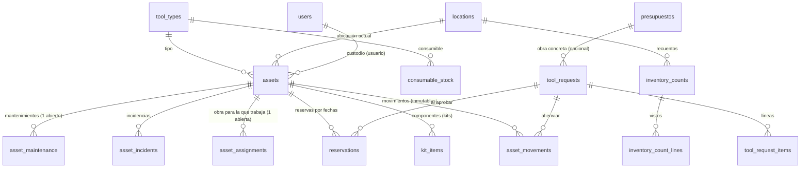

# Ledens Tools — herramientas y equipos

Módulo de `/plataforma` para saber, en todo momento y a partir de movimientos confirmados, qué herramientas tiene Ledens, dónde están, quién responde de ellas, para qué obra trabajan, cuáles están reservadas, cuáles hay que devolver y cuáles no se pueden usar.

- Backend: `src/herramientas/` (servicio), `src/routes/herramientas.js` (`/api/herramientas`), migración `042_herramientas.sql` (esquema `inventory`).
- Frontend: `src/components/plataforma/herramientas/` (carga diferida desde `Plataforma.jsx`), pestaña «Herramientas» de una obra (`obras/Detalle.jsx`), ruta `/h/:token` (etiquetas QR).
- Sin servicios nuevos de Azure: misma base de datos, mismo almacenamiento de fotos (Blob `obra-archivos`), misma autenticación por sesión.

---

## 1. Arquitectura

```
Teléfono / navegador (jefe de obra, administración)
  │  /plataforma  → Herramientas.jsx (lazy)   ·   /h/<token> → /plataforma?herramienta=<token>
  │  fetch /api/herramientas/*  (cookie de sesión · Origin · Idempotency-Key · X-Ledens-View-As)
  ▼
Express  routes/herramientas.js
  requireAuth → viewAs (solo GET) → checkRole(admin, jefe) → rate limit 300/min → comprobación de Origin
  ▼
HerramientasService (src/herramientas/)
  service.js      activos, movimientos, incidencias, mantenimiento, historial, QR, permisos por fila
  requests.js     solicitudes, disponibilidad, reservas, tabla de transiciones
  supervision.js  mis obras, obra, panel, avisos, recuentos, consumibles, importación CSV
  permissions.js  permisos por rol (tools.*)        sql.js / util.js  SQL compartido y validación
  ▼
PostgreSQL
  inventory.*  (este módulo)   public.users · public.presupuestos · audit_log   (reutilizados)
  ledens.projects · ledens.employees · ledens.finance_project_permissions      (solo lectura, sin FK)
Azure Blob (obra-archivos)  fotos de herramientas e incidencias, claves <assetId>/<uuid>
```

Decisiones:

1. **Proyecto = obra operativa.** Una herramienta trabaja para un `ledens.projects` (el mismo que enlaza presupuestos, Gantt y finanzas), aunque el proyecto tenga varias ampliaciones. La obra concreta (`presupuestos.id` raíz) es opcional en solicitudes y asignaciones.
2. **Sin claves foráneas hacia `ledens.*`** (igual que `presupuestos.project_id`, migración 033): ese esquema lo gestiona la importación contable. El servicio comprueba que el proyecto existe; columnas opcionales (`ledens.employees.activo`, `user_id`) se leen con `to_jsonb`.
3. **Obras de un jefe** = proyectos de las obras que tiene asignadas (`presupuestos.jefe_id`) + los que le da Gestión financiera (`ledens.finance_project_permissions`). La misma regla que «Presupuestos y obras».
4. **Ubicación ≠ custodio ≠ asignación ≠ reserva ≠ solicitud.** Cinco cosas distintas, cinco tablas distintas (§2).
5. **Concurrencia**: toda escritura sobre un activo toma antes su bloqueo de fila (`SELECT … FOR UPDATE`), en orden de id cuando son varios. Además la base de datos impone por sí misma «un traslado pendiente por activo» y «una asignación abierta por activo» (índices únicos parciales). No se usa `btree_gist`/`EXCLUDE` porque Azure Flexible Server exige añadirlo antes a `azure.extensions`.
6. **Historial inmutable**: los triggers rechazan `DELETE` en activos, movimientos, asignaciones, incidencias y libro de consumibles, y un movimiento solo cambia una vez (de «pendiente» a su resultado). Los errores se corrigen con un movimiento de **corrección** (administración, motivo obligatorio, `corrects_movement_id`).
7. **Idempotencia**: cabecera `Idempotency-Key` en las operaciones que un móvil puede reintentar (movimientos, recepciones, incidencias, solicitudes, aprobación, envío, reservas, consumibles). La clave se guarda en la misma transacción que el cambio; un duplicado devuelve la primera respuesta (`replayed: true`), incluso si llega a la vez.
8. **Avisos sin tabla**: `GET /avisos` los calcula del estado actual (como el resto de la campana de `/plataforma`): nunca se quedan desfasados ni se envían dos veces.

---

## 2. Modelo de datos (`042_herramientas.sql`)



| Tabla | Para qué |
|---|---|
| `tool_types` | Catálogo: nombre, categoría, **seguimiento** `individual` (A, QR por unidad) / `kit` (B) / `consumible` (C, por cantidad), unidad, mínimo. |
| `locations` | `almacen`, `obra` (una por proyecto, creada al primer envío), `vehiculo`, `taller`, `proveedor`, `externa`, `pendiente` (sistema: «Ubicación pendiente de confirmar»). |
| `assets` | Activos individuales y kits. Código permanente (`LED-TOOL-000042`, `KIT-FONTANERIA-001`), datos técnicos, propiedad (`propia`/`alquilada`/`tercero`), datos económicos (solo administración), **estado actual** (ubicación, custodio usuario *o* trabajador de `ledens.employees`, `condition`), `qr_token` opaco, baja lógica. |
| `kit_items` | Componentes de un kit y faltantes. |
| `asset_movements` | Cada movimiento físico: origen, destino, custodios, propósito (`alta`, `entrega`, `traslado`, `devolucion`, `reparacion`, `correccion`), estado `pendiente` → `recibido` / `cancelado` / `no_entregado`, quién envía y quién confirma. |
| `asset_assignments` | Para qué proyecto trabaja y hasta cuándo (`expected_return_on`). Se abre al recibir en una obra y se cierra al devolver a almacén o trasladar a otra obra. |
| `tool_requests` / `tool_request_items` | La petición del jefe: obra, fechas, líneas (tipo o unidad concreta, cantidad, cantidad aprobada). |
| `reservations` | Unidad concreta reservada para un proyecto entre dos fechas (`activa`/`cumplida`/`cancelada`). |
| `asset_incidents` | Avería, rotura, pérdida, robo, accesorio faltante, mantenimiento; `blocks_use`; foto. |
| `asset_maintenance` | Taller/proveedor, coste (solo administración), resultado `apta` / `sigue_averiada` / `baja`. |
| `inventory_counts` / `_lines` | Recuento físico de una ubicación. |
| `consumable_stock` / `consumable_ledger` | Existencias por tipo y ubicación, y cada entrada o consumo. |
| `idempotency_keys` | Respuesta guardada por `(usuario, clave)`. |

**Estado que ve el usuario** (derivado, nunca guardado): `baja` > `averiada` / `en_mantenimiento` / `perdida` / `robada` > `en_traslado` > `asignada` («En obra») > `reservada` > `disponible`.

**Bloqueo**: avería, rotura, pérdida y robo dejan la herramienta no apta siempre; accesorio faltante y mantenimiento solo si quien informa marca «no apta». Una no apta no se reserva, no se aprueba, no se envía a una obra; solo puede ir a reparar, volver a almacén o corregirse. Vuelve a `operativa` al cerrar el mantenimiento como «apta» o al resolver la incidencia marcando «vuelve a estar operativa».

---

## 3. API (`/api/herramientas`)

Errores: `{ error: 'texto en español', ...extra }` con el código HTTP adecuado (400 validación, 403 permiso, 404 no existe o no visible, 409 conflicto/estado, 413 tamaño, 415 formato, 422 clave de idempotencia reutilizada, 503 sin base de datos o sin almacenamiento de fotos). Las rutas estáticas se declaran antes que `/:id`.

| Método | Ruta | Quién | Qué |
|---|---|---|---|
| GET | `/` | lectura | Inventario. `q`, `estado` (`todas`, `disponibles`, `mi_obra`, `otras_obras`, `reservadas`, `averiadas`, `en_traslado`, `asignadas`, `baja`), `tipo`, `categoria`, `ubicacion`, `responsable`, `proyecto`, `pagina` (50). |
| GET | `/opciones` | lectura | Tipos, ubicaciones visibles, proyectos del usuario, posibles custodios (equipo + trabajadores sin cuenta), permisos. |
| GET | `/mis-obras` | lectura | Una tarjeta por obra: asignadas, pendientes de recibir, solicitudes, incidencias, devoluciones próximas/vencidas. |
| GET | `/obras/:projectId` | lectura (su obra) | Herramientas, envíos en camino, reservas y solicitudes de un proyecto. |
| GET | `/panel` | `tools.read.all` | KPIs y listas de administración; filtros `proyecto`, `ubicacion`, `categoria`, `responsable`. |
| GET | `/avisos` | lectura | Avisos de la campana. |
| GET | `/disponibilidad` | lectura | `tipo`, `desde`, `hasta`, `proyecto` → total, libres y unidades candidatas. |
| GET | `/etiqueta/:token` | lectura | Token de un QR → `{ id, code }` (404 si no existe o se sustituyó). |
| POST | `/etiquetas` | `tools.manage` | `{ ids }` → datos para imprimir. |
| POST | `/tipos`, `/ubicaciones` | `tools.manage` | Catálogo. |
| POST | `/importar[?simular=1]` | `tools.manage` | CSV (texto, 1 MB, 2000 filas). Todo o nada. |
| POST | `/` · PATCH `/:id` | `tools.manage` | Alta · edición de ficha (`version` obligatoria; 409 si cambió). |
| GET | `/:id` | lectura | Ficha (id o código) + `actions` permitidas. |
| GET | `/:id/historial` | su ámbito | Movimientos, asignaciones, reservas, incidencias, mantenimientos. |
| GET | `/:id/qr.svg` | `tools.manage` | Etiqueta QR (SVG). |
| GET/PUT | `/:id/foto` | lectura / `tools.manage` | Foto (JPG/PNG/HEIC por contenido, 15 MB). |
| POST | `/:id/baja` · `/:id/etiqueta` | `tools.manage` | Baja lógica · sustituir etiqueta (motivo). |
| PUT · PATCH | `/:id/componentes` · `/:id/componentes/:itemId` | `tools.manage` · custodio/su obra | Componentes de kit · faltantes. |
| POST | `/:id/incidencias` | `tools.maintenance.report` | `{ kind, description, blocksUse }`. Foto: `POST /incidencias/:id/foto`. |
| POST | `/:id/mantenimiento` · `/:id/mantenimiento/cerrar` | `tools.maintenance.manage` | Abrir · cerrar (`result`, `cost`, `notes`). |
| POST | `/incidencias/:id/resolver` | `tools.maintenance.manage` | `{ resolution, backInService }`. |
| GET | `/movimientos/pendientes` | lectura | `toReceive` (los que puedo confirmar) y `sent`. |
| POST | `/movimientos` | `tools.transfer` | `{ assetId, purpose, toLocationId \| toProjectId, toCustodian: { type: 'user'\|'employee', id }, notes, receiveNow }`. |
| POST | `/movimientos/:id/recibir` | quien recibe | `{ notes, incident? }` — recibir (y, si llega mal, registrar la incidencia a la vez). |
| POST | `/movimientos/:id/cancelar` · `/no-entregado` | emisor/admin · receptor/emisor/admin | `{ reason }`. |
| GET · POST | `/solicitudes` | lectura · `tools.request` | Lista (`estado`, `proyecto`, `mias`) · crear `{ projectId, obraId?, neededFrom, returnBy, notes, items: [{ typeId, assetId?, quantity }], draft }`. |
| GET | `/solicitudes/:id` | solicitante / su obra / aprobador | Detalle, `suggestions` (unidades libres por línea) y `actions`. |
| POST | `/solicitudes/:id/{presentar,revisar,aprobar,rechazar,preparar,despachar,finalizar,cancelar}` | ver §4 | `aprobar`: `{ items: [{ itemId, assetIds }], reason }` (motivo obligatorio si es parcial). |
| POST | `/reservas` · `/reservas/:id/cancelar` | `tools.requests.approve` | Reserva directa · cancelar. |
| GET · POST | `/consumibles` · `/consumibles/ajustes` | lectura · admin (jefe: solo consumos en sus obras) | Existencias · `{ typeId, locationId, delta, reason }`. |
| POST/GET | `/recuentos`, `/recuentos/:id`, `/recuentos/:id/vistos`, `/recuentos/:id/cerrar` | `tools.manage` | Recuento físico. |

### Transiciones de una solicitud

```
borrador ──► solicitada ──► en_revision ──┬──► aprobada ───────────────┬──► en_preparacion ──► en_traslado ──► entregada ──► finalizada
   │             │               │        ├──► parcialmente_aprobada ──┘                          │  (todas recibidas)   (todas devueltas)
   │             │               │        └──► rechazada                                         └─► en_preparacion (ningún envío llegó)
   └─────────────┴───────────────┴──► cancelada (también desde aprobada / parcial / en_preparación, por administración)
```

Tabla cerrada en `REQUEST_TRANSITIONS` (`requests.js`); cualquier otro salto es 409. «Entregada» y «finalizada» se alcanzan solas a partir de las recepciones y devoluciones.

---

## 4. Permisos (backend: `permissions.js`; pantalla de usuario: `plataforma/data.js`)

| Permiso | admin | jefe | cliente |
|---|:-:|:-:|:-:|
| `tools.read` — herramientas de sus obras y disponibilidad | ✔ | ✔ | — |
| `tools.read.all` — todo el inventario con ubicaciones y custodios | ✔ | — | — |
| `tools.manage` — alta, edición, etiquetas, bajas, datos económicos, CSV, recuentos | ✔ | — | — |
| `tools.request` — solicitar para sus obras | ✔ | ✔ | — |
| `tools.requests.approve` — aprobar, rechazar, preparar, enviar, reservar | ✔ | — | — |
| `tools.transfer` — mover lo que está en sus obras o bajo su custodia | ✔ | ✔ | — |
| `tools.receive` — confirmar lo dirigido a él o a sus obras | ✔ | ✔ | — |
| `tools.maintenance.report` — registrar incidencias | ✔ | ✔ | — |
| `tools.maintenance.manage` — mantenimientos y resolución | ✔ | — | — |
| `tools.audit.read` — historial completo | ✔ | — (solo de sus obras) | — |

Además, por fila: un jefe solo actúa sobre activos de sus proyectos o bajo su custodia; fuera de ellos ve «Otra obra», sin custodio, sin número de serie y nunca costes. Nunca aprueba (tampoco sus propias solicitudes). «Ver como» responde como el usuario visto y solo con `GET`. Un cliente recibe 403 en todo el módulo.

---

## 5. QR

- **Contenido**: `https://<app>/h/<token>`. El token son 80 bits aleatorios (base64url, ~14 caracteres), sin significado. No lleva nombre, código, id interno ni credenciales. La URL corta mantiene los módulos grandes (corrección de errores M, ~15 %).
- **Escanear**: con la cámara dentro de la plataforma (`BarcodeDetector`, Chrome/Edge en Android y escritorio) o con la app Cámara del iPhone, que abre el enlace. Sin sesión, `/plataforma` pide iniciar sesión y vuelve a la ficha (RequireAuth conserva la consulta). El token desaparece de la barra de direcciones al entrar.
- **El QR no concede nada**: `/etiqueta/:token` exige sesión y rol; la ficha aplica los permisos del usuario.
- **Etiqueta gastada** → «Reimprimir etiqueta» (mismo token). **Etiqueta perdida o robada** → «Sustituir etiqueta» (token nuevo, `label_version + 1`, la anterior deja de funcionar, motivo en auditoría). El código `LED-TOOL-…` no cambia nunca y se puede teclear en «Escanear QR».
- **Impresión**: «Inventario → Etiquetas QR», hojas A4 de 3 × 8 etiquetas de 70 × 37 mm.
- `staticwebapp.config.json`: `Permissions-Policy` pasa de `camera=()` a `camera=(self)` (solo nuestro origen; micrófono y ubicación siguen bloqueados). Sin este cambio el navegador bloquea la cámara en toda la web.

---

## 6. Guía para jefes de obra (móvil)

Menú → **Herramientas** (pestañas *Mi obra · Inventario · Escanear QR*) y **Mis solicitudes**. También la pestaña **Herramientas** dentro de cada obra.

1. **Me llega una herramienta** → aparece arriba en «Pendientes de recibir» → **Confirmar recepción**. Si llega rota o incompleta: escanéala → **Ha llegado con un problema**. Si no llega: **No ha llegado** (queda «pendiente de confirmar» para administración).
2. **Necesito herramientas** → **Solicitar herramienta** → obra, herramientas y cantidades (ves cuántas hay libres esas fechas), fechas, observaciones → **Enviar solicitud**. Lo escrito se guarda en el teléfono hasta que se envía.
3. **Paso una herramienta a otra persona u obra** → escanea → **Trasladar / entregar** → destino y quién la recibe. Si la recibe alguien de tu obra y está delante, marca «Ya está en destino».
4. **Devuelvo** → escanea → **Devolver a almacén**. Administración confirma la llegada.
5. **Se ha roto / falta algo / la han robado** → escanea → **Reportar incidencia** (foto opcional). Avería, rotura, pérdida y robo la bloquean hasta revisión.
6. **Kit incompleto** → en la ficha del kit, ajusta «faltan» en cada componente.

Sin cobertura: verás un aviso; nada se marca como hecho si el servidor no lo ha guardado; **Reintentar** no lo registra dos veces.

## 7. Guía para administración

- **Panel de herramientas**: KPIs (total, disponibles, en obra, reservadas, en traslado, averiadas/mantenimiento, perdidas, solicitudes por aprobar, devoluciones vencidas), filtros por obra, ubicación, categoría y responsable; listas de vencidas, incidencias, alquileres que terminan y consumibles bajo mínimos.
- **Inventario**: **Dar de alta** (tipo nuevo desde el mismo formulario), **Importar CSV** (siempre se comprueba antes; un error ⇒ no se importa nada), **Etiquetas QR**. En la ficha: editar, foto, reimprimir o sustituir etiqueta, reservar, corregir ubicación, abrir/cerrar mantenimiento, dar de baja (nunca se borra).
- **Solicitudes**: la bandeja preselecciona unidades libres; desmarca o elige otras → **Aprobar y reservar** (parcial: motivo obligatorio) o **Rechazar** (motivo). Luego **Marcar en preparación** y **Enviar a obra** (crea los traslados; el jefe confirma cada recepción).
- **Operaciones**: traslados pendientes (confirmar devoluciones a almacén), consumibles (entradas y salidas), recuento físico (escanear/teclear lo que hay; el cierre lista faltantes y fuera de sitio — se corrigen con correcciones o incidencias, nunca solos), ubicaciones (almacenes, vehículos, talleres…).
- **Auditoría**: cada operación queda en `audit_log` («Herramienta enviada», «Recepción de herramienta confirmada», «Solicitud de herramientas: aprobada», …).

Importación CSV (`;` o `,`, cabecera obligatoria): `tipo;categoria;seguimiento;nombre;marca;modelo;numero_serie;propiedad;propietario;fecha_adquisicion;coste;proveedor;garantia;ubicacion;observaciones`. Obligatorias `tipo`, `categoria`, `nombre`; `ubicacion` es el nombre de una ubicación existente (vacío = Almacén central).

---

## 8. Pruebas

- `test/herramientas.test.js` (PGlite; con `TOOLS_TEST_DATABASE_URL` también PostgreSQL 16 real y los casos de concurrencia): alta, consulta por proyecto, permisos (costes ocultos, Origin, «Ver como», clientes), solicitudes, aprobación parcial, reservas, conflictos, traslado, recepción, devolución, averías y bloqueo, idempotencia, concurrencia (dos aprobaciones del mismo martillo, tres traslados simultáneos, doble recepción, misma clave a la vez), historial inmutable, QR, panel, avisos, consumibles, kits, recuentos, CSV.
- `ledens/frontend/test/herramientas.test.js` (`npm test`): lectura de QR/códigos, etiquetas de estado, filtros, permisos, borradores.
- CI (`backend-finance-tests.yml`): paso «Ledens Tools … on PostgreSQL 16» y «Frontend unit tests».

## 9. Despliegue y rollback

**Despliegue** (nada automático a producción desde la rama):
1. Revisar y fusionar el PR en `main`. El workflow del backend construye la imagen y crea una revisión de ACA; al arrancar aplica `042_herramientas.sql` (aditiva: esquema nuevo, no toca tablas existentes) bajo el bloqueo consultivo de migraciones.
2. El workflow de SWA publica el frontend (incluye el cambio de `Permissions-Policy` para la cámara).
3. Comprobar: `/api/health`; como administración, «Herramientas → Panel» muestra 0 activos; dar de alta una herramienta de prueba solo si se quiere, y darla de baja después (no se borra).
4. Carga inicial: «Inventario → Importar CSV» con el inventario real (comprobar primero), imprimir etiquetas, pegarlas.
5. Fotos: reutiliza `OBRA_ARCHIVOS_BLOB_URL`; sin él, solo las fotos responden 503.

**Rollback**:
- Código: revertir el commit de fusión (frontend y backend vuelven a la revisión anterior). La migración 042 puede quedarse: el código anterior no lee el esquema `inventory`.
- Datos: nunca se borran por la interfaz. Eliminar el esquema solo si se decide expresamente y tras una copia: `DROP SCHEMA inventory CASCADE; DELETE FROM schema_migrations WHERE name='042_herramientas.sql';` (destructivo, manual).

## 10. Riesgos y pendientes

- **Modo sin conexión (PWA)**: no incluido. Hoy: aviso de sin conexión, borradores locales de formularios, reintento idempotente. Una PWA con cola local exigiría reglas de conflicto (p. ej. una recepción encolada sobre un traslado ya cancelado ⇒ se descarta y se avisa; nunca se da por confirmado un movimiento no sincronizado).
- **iPhone**: Safari no tiene `BarcodeDetector`; se usa la app Cámara (abre el enlace). Si se quisiera escanear dentro de la página en iOS haría falta un lector JS (p. ej. jsQR, ~40 kB).
- **Notificaciones por correo**: no incluidas (solo campana). La cola de notificaciones existente (`NOTIFICATIONS.md`) podría enviar «transferencia pendiente» o «devolución vencida» si se quiere.
- **Navegación móvil de la plataforma**: por debajo de 900 px la plataforma apila el menú lateral completo; en las pantallas de herramientas el contenido va primero. Un menú plegable para toda la plataforma sería un cambio aparte.
- **Integración futura** (no hecha, modelo preparado): `assets.invoice_document_id` → `ledens.documents`; coste de reparación en `asset_maintenance.cost`; alquileres (`ownership='alquilada'`, `rental_ends_on`); utilización a partir de `asset_assignments`; sugerencias de herramientas por partidas del Gantt (siempre revisadas por el jefe, nunca reservas automáticas). Ninguna imputación contable automática.
- **Límite global `/api` (30/min por IP)**: el módulo tiene el suyo propio (300/min), montado antes; no le afecta.
